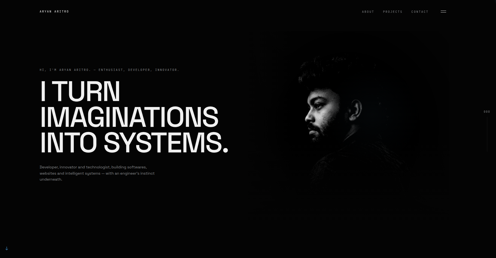

<div >

## MSTIA Challenge 09 - Personal Portfolio Website

### A modern, and responsive personal portfolio.


**A digital introduction to my skills, projects, and professional background.**



[Visit Site](https://aryanaritro.vercel.app/)

</div>

---

## Project Overview

This project is a personal portfolio website created to demonstrate modern web design principles, responsive layouts, and professional presentation.

It showcases portfolio components through a clean visual interface while maintaining a consistent design language, typography, and color scheme.

## Key Features

- **Modern Interface** — Clean layout with consistent typography and visual hierarchy.
- **Responsive Design** — Adaptable presentation across desktop, tablet, and mobile screens.
- **Professional Showcase** — Dedicated sections for personal introduction, skills, and projects.
- **Project Presentation** — Structured project descriptions with relevant links.
- **Contact Access** — Convenient contact information and communication links.
- **Minimal Implementation** — Focused functionality without unnecessary complexity for only cover the contest's criterias.

## Website Sections

| Section | Description |
|---|---|
| Home | Introduction and portfolio landing section |
| About Me | Personal background and professional interests |
| Skills | Overview of technical skills |
| Projects | Selected projects with descriptions and links |
| Contact | Contact information and communication options |

## Design Philosophy

The website follows a minimal, technology-inspired visual direction.

Key design considerations:

- Consistent color palette.
- Clear typography and readable text hierarchy.
- Balanced spacing and visual alignment.
- Minimal visual distractions.
- Consistent components and navigation.
- Responsive presentation for different screen sizes.

## Responsiveness

The interface is designed to accommodate different screen sizes:

| Device | Design Focus |
|---|---|
| Desktop | Full layout and navigation |
| Tablet | Adapted spacing and component arrangement |
| Mobile | Compact layout and accessible navigation |

## Technology Stack

- **Frontend:** [TypeScript, TypeScript JSX, Vite, React, HTML, CSS]
- **Styling:** [Add styling technology]
- **Deployment:** [Vercel]

## Run Locally

Clone the repository:

```bash
git clone YOUR_GITHUB_REPOSITORY_URL
```

Navigate into the project directory:

```bash
cd YOUR_PROJECT_DIRECTORY
```

Install dependencies (if applicable):

```bash
npm install
```

Start the development server:

```bash
npm run dev
```

*Adjust the commands according to the actual project setup.*

## 🌐 Deployment

The website is deployed and accessible online:

**Live Website:** https://aryanaritro.vercel.app/

## Competition Information

| Field | Details |
|---|---|
| Competition | ASL National Arena |
| Challenge | #09 |
| Category | Software Development |
| Project | Personal Portfolio Website |
| Maximum Score | 100 Points |
| Submission Format | GitHub |

### Evaluation Milestones

| Milestone | Description | Points |
|---|---|---:|
| 01 | Design & Aesthetics | 30 |
| 02 | Responsiveness & UI/UX | 30 |
| 03 | Content & Functionality | 30 |
| 04 | Code Quality & Deployment | 10 |
| | **Total** | **100** |

## Developer

**Aryan Aritro**

Aspiring Engineer · Web Developer · Technology Enthusiast

---

<div align="center">

### Built with purpose. Designed with simplicity.

**ASL National Arena — Challenge #09**

</div>